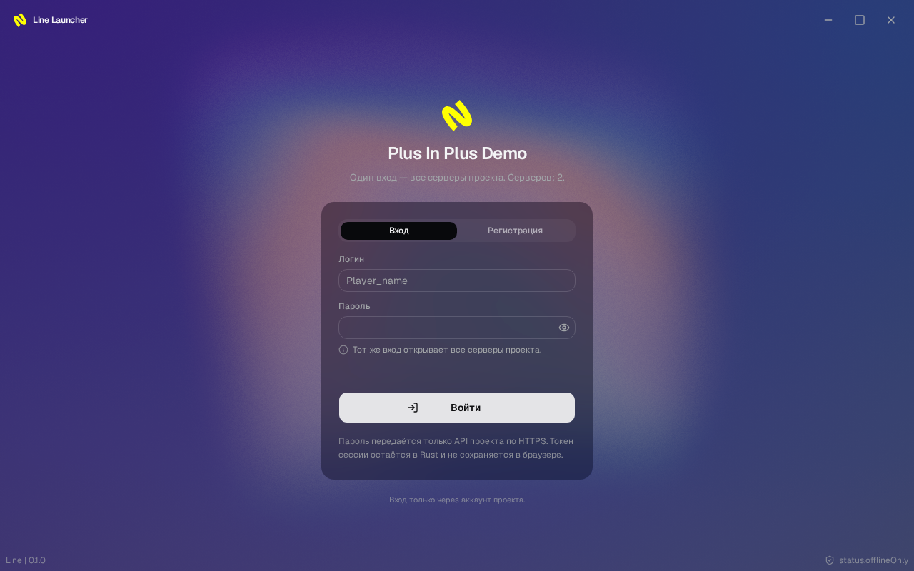
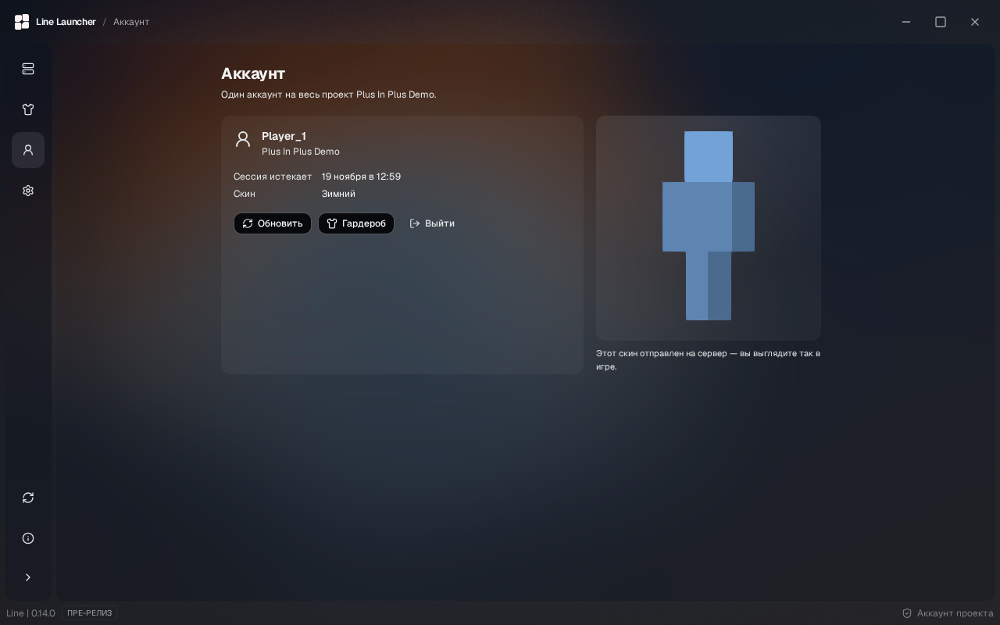
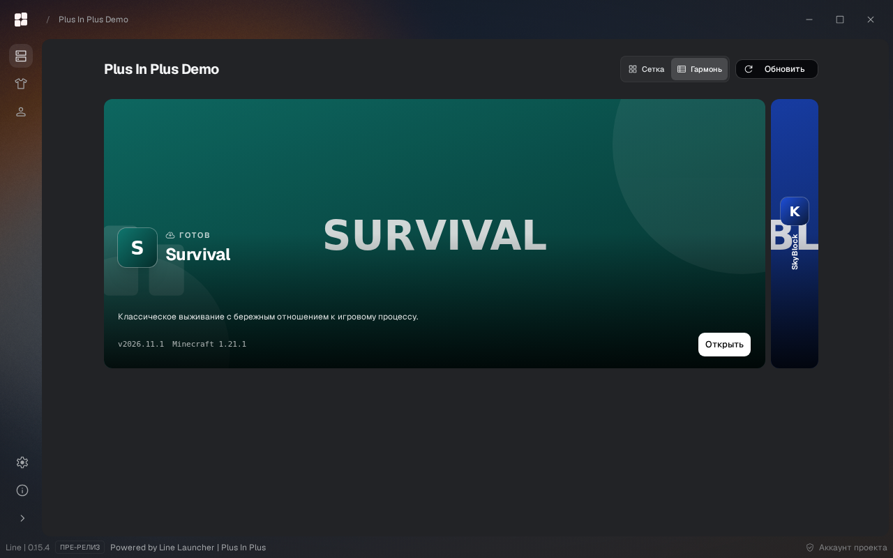

<div align="center">

# Line Launcher

**Минималистичный Minecraft-лаунчер для игровых проектов.**
Один провайдер — один лаунчер. Игрок регистрируется и нажимает «Играть».

[](https://tauri.app)
[](https://www.rust-lang.org)
[](https://react.dev)
[](https://www.typescriptlang.org)
[](#сборка)

</div>


<div align="center">

**[Собрать с нуля](docs/BUILD.md)** · **[Начать работу](docs/START.md)** · **[Демо-режим](docs/DEMO.md)** · **[Провайдеру](docs/PROVIDER.md)**

</div>

---

## Что это

Лаунчер знает адрес своего проекта — он зашит на этапе сборки. Никаких ссылок,
настроек подключения и выбора провайдера: открыл, вошёл один раз, играешь на
любом сервере проекта.

Владелец проекта собирает приложение под себя: иконки, название, шрифты, фон,
адрес API. Игрок получает лаунчер, в котором нет ничего, кроме его проекта.

<table>
<tr>
<td width="50%"><br><sub><b>Приветствие.</b> Слово «Welcome» пишется от руки одним движением пера и уступает странице входа.</sub></td>
<td width="50%"><br><sub><b>Один вход.</b> Аккаунт проекта, без выбора между Mojang, Microsoft и офлайн-режимом.</sub></td>
</tr>
<tr>
<td><br><sub><b>Сервер.</b> Установка, проверка сборки, запуск и откат — на одной странице.</sub></td>
<td><br><sub><b>Профиль.</b> Скин в 3D, ник и статистика — без переходов на сайт проекта.</sub></td>
</tr>
<tr>
<td><br><sub><b>Режим Minecraft.</b> Своя сборка, свой мир, тот же вход, что и на сервере проекта.</sub></td>
<td><br><sub><b>Гардероб.</b> Скины проекта: выбрать, примерить, применить.</sub></td>
</tr>
<tr>
<td colspan="2"><br><sub><b>Гармонь.</b> Компактный список с одной раскрытой карточкой; сетка остаётся видом по умолчанию.</sub></td>
</tr>
<tr>
<td><br><sub><b>Настройки.</b> Память под сборку, Java, фон и поведение после запуска.</sub></td>
<td><br><sub><b>Рабочая зона.</b> По умолчанию панели сплошные, тёмно-серые; фон и анимация остаются. Прозрачное стекло можно выбрать отдельно.</sub></td>
</tr>
</table>

## Почему он такой

Это не «ещё один лаунчер с миллионом настроек». Решения приняты в пользу игрока,
который не должен читать форумы, чтобы поиграть:

- **Провайдер один, и он зашит.** Нет экрана выбора провайдера и нет страницы
  с адресами — их нечего настраивать.
- **Каталог подстраивается под привычку.** Сетка показывает карточки и баннеры,
  а «Гармонь» собирает серверы в компактный список с одной раскрытой карточкой.
  Сетка остаётся видом по умолчанию.
- **Фон не исчезает за сплошными панелями.** По умолчанию главные панели —
  непрозрачные, тёмно-серые, как в JetBrains IDE; анимированный фон остаётся
  вокруг них. Прозрачное стекло можно включить в настройках.
- **Сборка проверяется до запуска, а не после падения.** Лаунчер сверяет файлы
  с подписанным манифестом и говорит, что именно не так, а не «игра
  закрылась».
- **Чужие моды не удаляются.** Файл неизвестного происхождения лаунчер не
  трогает сам: он показывает список и предлагает перенести его в карантин,
  откуда файл можно вернуть.
- **Память подбирается под сборку.** Тяжёлой сборке — больше, лёгкой — меньше,
  но никогда больше, чем компьютер может отдать.
- **Java приходит сама.** Не «скачайте JDK 21 откуда-нибудь и укажите путь».

## Что внутри

- **Один провайдер на сборку.** Адрес `config.json` задаётся в
  `branding/provider.json` до сборки; серверы приходят из этого конфига.
- **Брендинг на этапе сборки.** Название, палитра, логотип и иконки — из одного
  файла; базовая палитра интерфейса фиксирована.
- **Один аккаунт проекта.** Регистрация и вход один раз на весь лаунчер, сессия
  в Rust, одноразовый launch ticket на конкретный сервер и приватный IPC вместо
  передачи токена через аргументы JVM.
- **Целостность сборок.** Потоковая загрузка с SHA-256, защита от zip-slip,
  атомарная публикация, история релизов и откат.
- **Конфиг с кэшем.** TTL и ETag, показ кэша сразу с фоновой перепроверкой,
  безопасный отказ при несовместимой версии.
- **Локальный гардероб.** История скинов в app data, адресация по содержимому,
  идемпотентная синхронизация только активного скина.
- **Свой интерфейс.** Одна рамка окна, сворачиваемая навигация, тёмная палитра,
  Tailwind v4, Base UI, Framer Motion и Material Symbols Rounded.

Чего сознательно нет: аккаунтов Microsoft и офлайн-режима, ручного выбора
загрузчиков, аддонов и произвольных JVM-флагов.

## Сборка

Нужны Node.js 22+, Rust (stable) и зависимости Tauri для вашей платформы.

```bash
npm ci
npm run dev          # запуск в режиме разработки
npm run check        # TypeScript
npm test             # весь набор автоматических тестов
npm run build        # сборка фронтенда
```

Установщик собирается через `npm run tauri build`; пошаговая инструкция для
новичка — в [docs/BUILD.md](docs/BUILD.md).

## Данные на компьютере

Каталог app data пользователя: `config-cache.json`, `skins/` и
`instances/<server-id>/` с проверенными релизами и атомарным указателем текущего.
У каждого сервера своя сборка (`releases/<sha256>`) и свой каталог игрока
(`game/`): миры и настройки не пересекаются и не теряются при обновлении. Перед
запуском каждый файл сборки сверяется с индексом SHA-256; игровые моды и
ресурс-паки проверяются отдельно ([GAME.md](docs/GAME.md),
[ANTICHEAT.md](docs/ANTICHEAT.md)). Рядом — `launcher_logs/`, логи самого
лаунчера по файлу в сутки ([LOGGING.md](docs/LOGGING.md)). Пароли и токены на
диск и в WebView не сохраняются и в логи не попадают.

## Статус

Проект не объявлен production-релизом: установка реальной сборки проверялась на
Windows, но текущие изменения требуют повторных проверок на живых экземплярах и
установщике. Что проверено локально, а что требует вашей среды —
[VERIFICATION.md](docs/VERIFICATION.md).

## Документация

| Документ                                | О чём                                                                        |
| --------------------------------------- | ---------------------------------------------------------------------------- |
| [BUILD.md](docs/BUILD.md)               | Собрать с нуля: какие программы, какие файлы менять, как получить установщик |
| [START.md](docs/START.md)               | Короткая инструкция для игрока, провайдера и разработчика                    |
| [DEMO.md](docs/DEMO.md)                 | `npm run demo` — локальный провайдер и настоящее приложение                  |
| [PROVIDER.md](docs/PROVIDER.md)         | Формат конфигурации и манифеста сборки                                       |
| [VERIFICATION.md](docs/VERIFICATION.md) | Что и как проверялось                                                        |

## Происхождение и лицензия

Разработан **Plus In Plus** на основе
[Obsy Launcher](https://github.com/obsy-official/obsy-launcher).

Оригинальные материалы Line — [Line Launcher Provider License 1.0](LICENSE):
source-available лицензия для провайдеров игровых серверов с обязательным
видимым упоминанием **Line Launcher | Plus In Plus**. Это не MIT и не
open-source лицензия. Разрешены интеграция, коммерческое использование для своих
игровых сервисов и распространение брендированных сборок их игрокам при
соблюдении условий; удаление упоминания прекращает разрешение.

Точные фразы — «Работает на Line Launcher | Plus In Plus» и «Powered by Line
Launcher | Plus In Plus». Место (футер или шапка) и язык выбираются в
`branding/line.brand.json`; «О программе» всегда повторяет упоминание.

Исходные материалы Obsy остаются под MIT: дословный текст сохранён в
[LICENSES/Obsy-MIT.txt](LICENSES/Obsy-MIT.txt). Сторонние уведомления —
[NOTICE.md](NOTICE.md). Перед публичным коммерческим релизом рекомендуется
юридическая проверка текста под вашу юрисдикцию.

<div align="center">

**Plus In Plus** · 2026

</div>
