<div align="center">

# Line Launcher

**Минималистичный Minecraft-лаунчер для игровых проектов.**
Один провайдер — один лаунчер. Игрок регистрируется и нажимает «Играть».

[](https://tauri.app)
[](https://www.rust-lang.org)
[](https://react.dev)
[](https://www.typescriptlang.org)
[](#сборка)

</div>

<!-- CUSTOM BRAND ART SLOT: разместите здесь широкую иллюстрацию проекта или
     фирменный hero-баннер. Скриншоты интерфейса ниже остаются нейтральными,
     чтобы их можно было использовать в брендированных сборках. -->

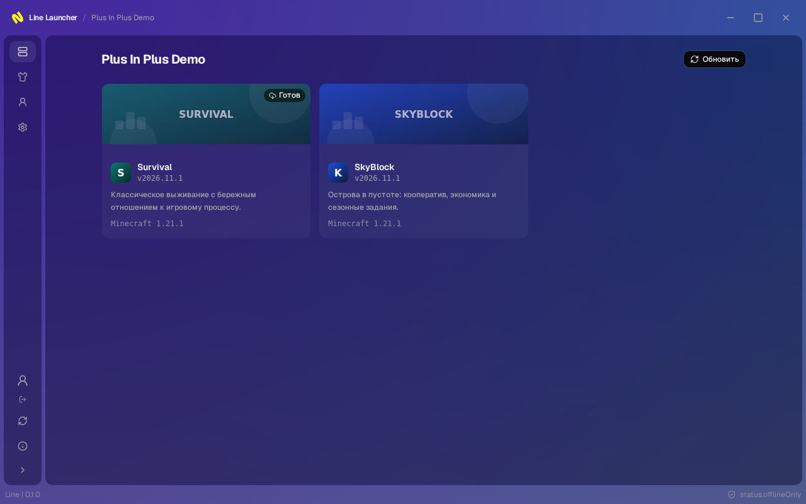

<div align="center">

**[Собрать с нуля](docs/BUILD.md)** · **[Начать работу](docs/START.md)** · **[Встроенный справочник](#встроенный-справочник-игрока-и-gif-демонстрации)** · **[Справочник игрока](docs/guidebook/README.md)** · **[Первый запуск](docs/guidebook/FIRST-RUN.md)** · **[Демо-режим](docs/DEMO.md)** · **[Провайдеру](docs/PROVIDER.md)

</div>

---

## Что это

Лаунчер знает адрес своего проекта — он зашит на этапе сборки. Игрок не выбирает
провайдера и не вводит адреса серверов: один вход открывает каталог проекта.
При первом запуске мастер помогает выбрать язык, фон и движение; затем можно
войти или зарегистрироваться. Согласие на телеметрию, если провайдер её
настроил, всегда необязательно и выключено по умолчанию.

Владелец проекта собирает приложение под себя: название, логотип, иконки и адрес
API. Игрок получает лаунчер, в котором нет ничего, кроме нужного проекта.

<table>
<tr>
<td width="50%">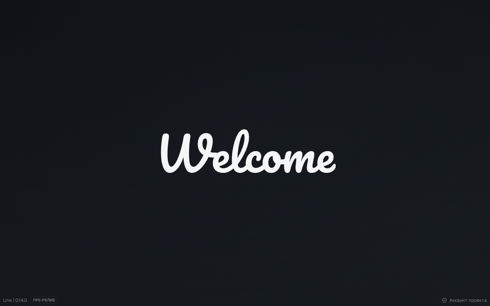<br><sub><b>Приветствие.</b> Короткая рукописная заставка уступает место настройке.</sub></td>
<td width="50%">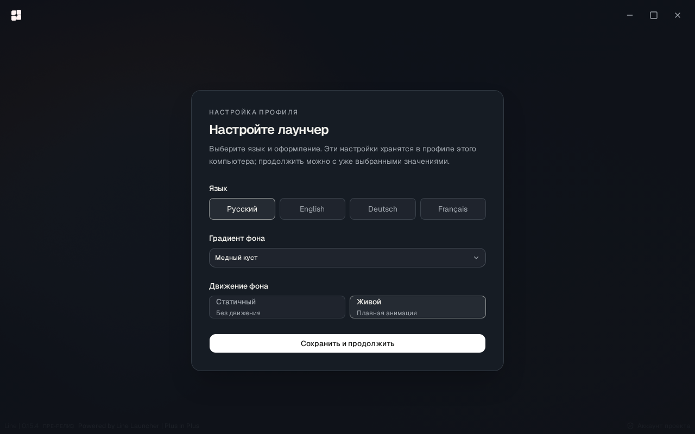<br><sub><b>Первый запуск.</b> Язык, градиент фона и движение выбираются до входа.</sub></td>
</tr>
<tr>
<td><br><sub><b>Один вход.</b> Аккаунт проекта; не аккаунт Microsoft. Minecraft-серверы с online-mode=true потребуют отдельную серверную авторизацию.</sub></td>
<td><br><sub><b>Каталог.</b> Последний сервер, поиск, фильтры и живой статус, если его публикует провайдер.</sub></td>
</tr>
<tr>
<td><br><sub><b>Сборка проекта.</b> Играть, проверить целостность, подготовить заранее или откатить релиз.</sub></td>
<td>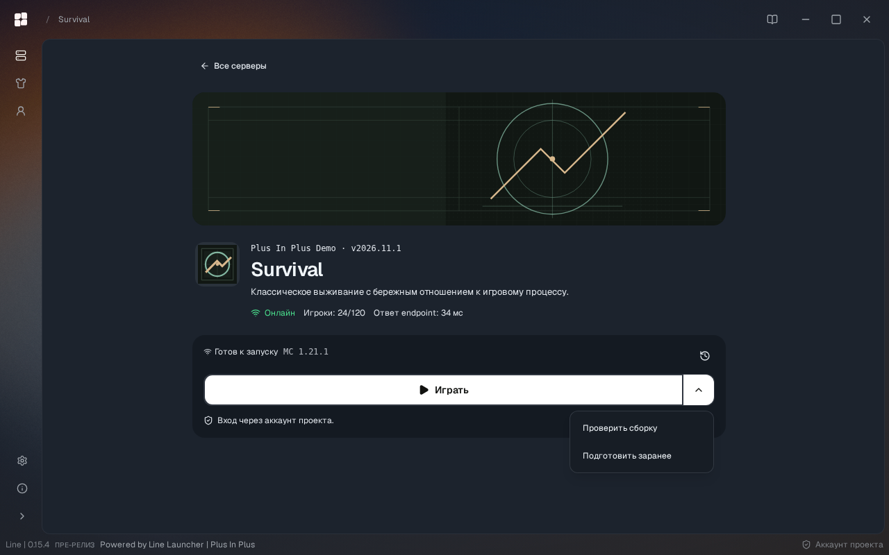<br><sub><b>Действия.</b> Проверка сборки не меняет файлы; подготовка и запуск доступны отдельно.</sub></td>
</tr>
<tr>
<td>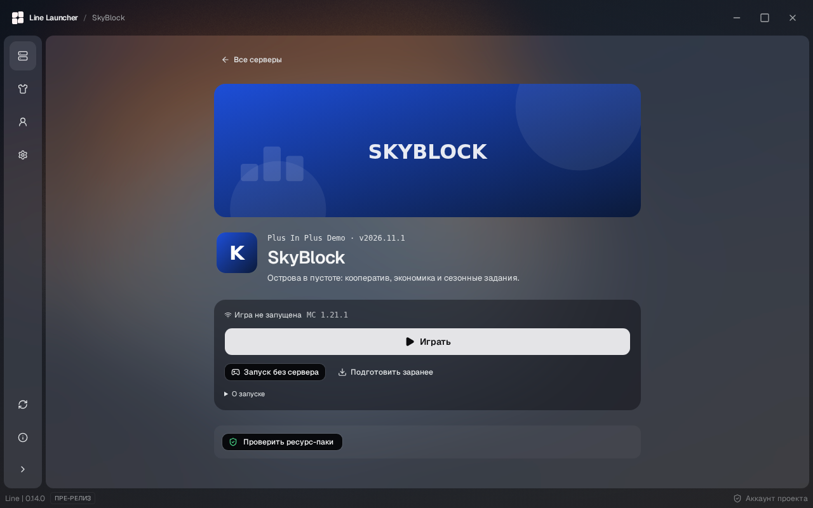<br><sub><b>Режим Minecraft.</b> Поддерживаемая провайдером сборка и запуск в один клик.</sub></td>
<td>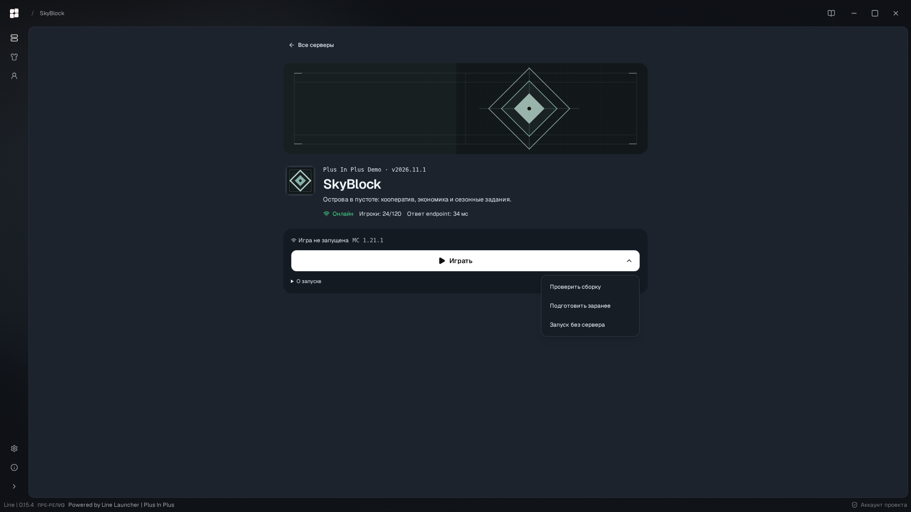<br><sub><b>Дополнительные действия.</b> Подготовить сборку или запустить без подключения к серверу.</sub></td>
</tr>
<tr>
<td>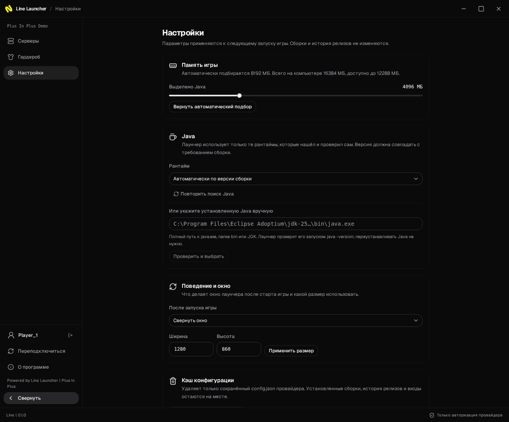<br><sub><b>Настройки.</b> Память, Java, внешний вид, окно и данные.</sub></td>
<td>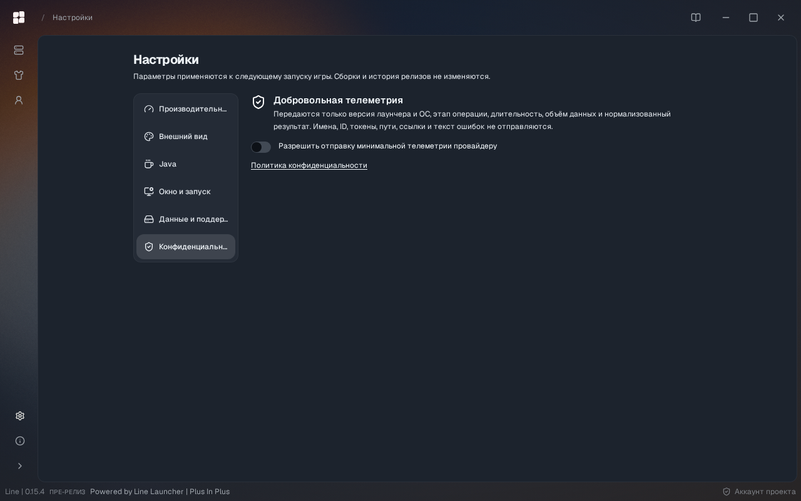<br><sub><b>Приватность.</b> Отдельный выключенный по умолчанию opt-in и ссылка на политику провайдера.</sub></td>
</tr>
<tr>
<td><br><sub><b>Гардероб.</b> История скинов проекта и предварительный просмотр.</sub></td>
<td><br><sub><b>Профиль.</b> Данные аккаунта и 3D-просмотр; серверная статистика появится после согласования API.</sub></td>
</tr>
<tr>
<td colspan="2">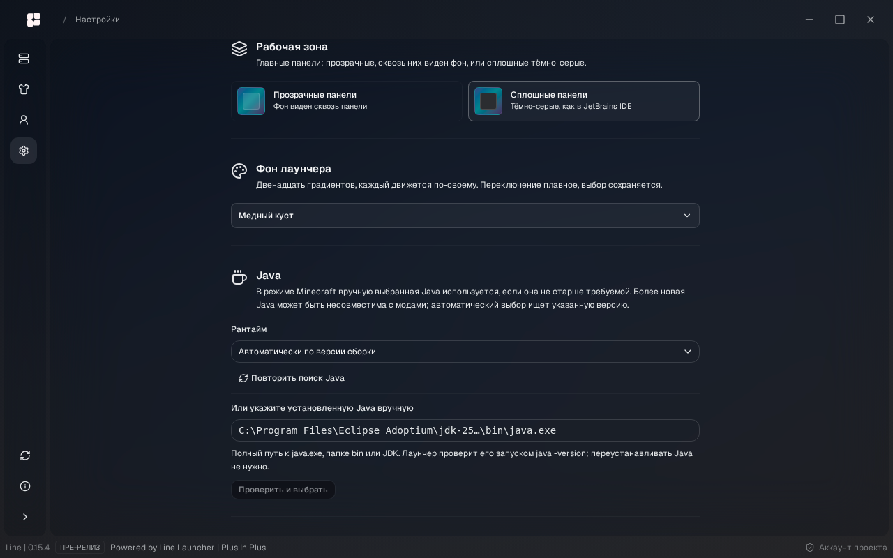<br><sub><b>Рабочая зона.</b> Отделка панелей настраивается отдельно от градиента и движения фона.</sub></td>
</tr>
</table>

## Встроенный справочник игрока и GIF-демонстрации

При первом входе после авторизации лаунчер предлагает справочник. Закройте его,
если сейчас не нужен: кнопка книги в шапке окна откроет его позже. Выберите одну
из шести тем в списке — главы доступны напрямую и не требуют проходить их по
порядку. Короткая инструкция объясняет задачу; GIF показывает дополнительный
пример настоящего интерфейса. Анимация не запускается сама — включите её кнопкой
воспроизведения и остановите на постере в любой момент. При reduced-motion
сразу показывается статичный постер. Подпись к кнопке книги появляется при
наведении или клавиатурном фокусе.

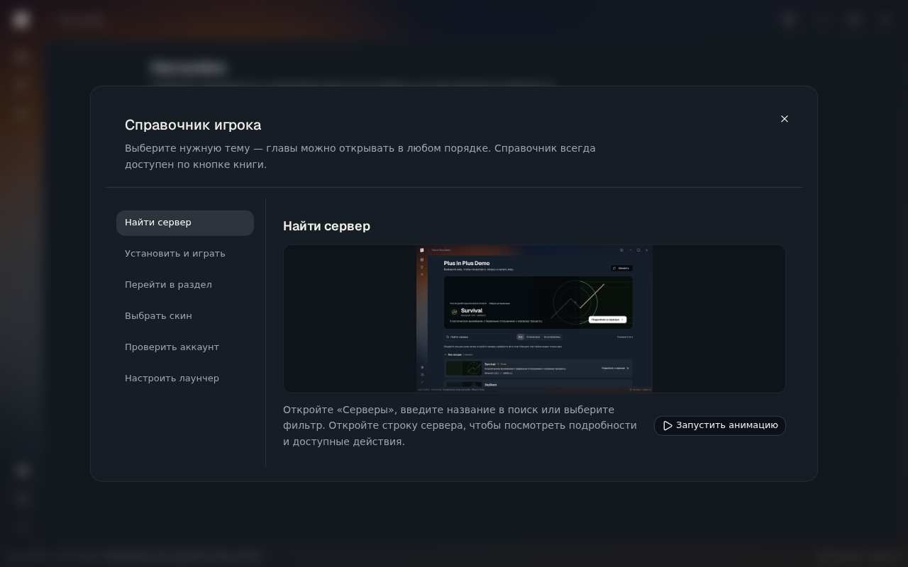

<sub><b>Повторный запуск.</b> Иконка книги в шапке окна снова открывает эти страницы без выхода из аккаунта.</sub>

<table>
<tr>
<td width="50%"><a href="public/guidebook/servers.gif">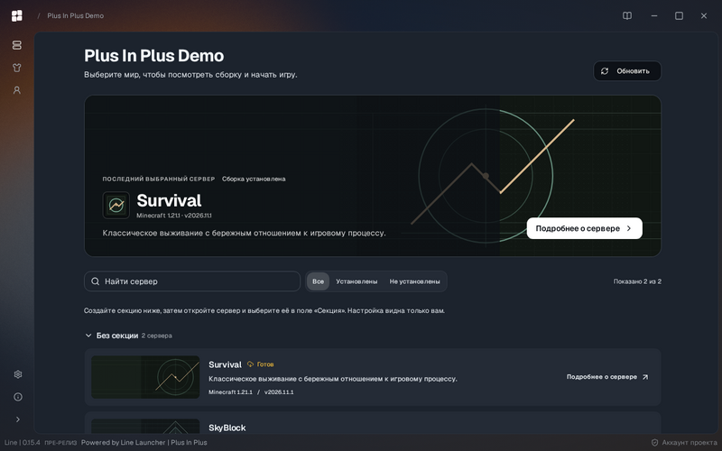</a><br><sub><b>Найти сервер.</b> Ищите по названию, откройте сервер и вернитесь к каталогу.</sub></td>
<td width="50%"><a href="public/guidebook/server-actions.gif">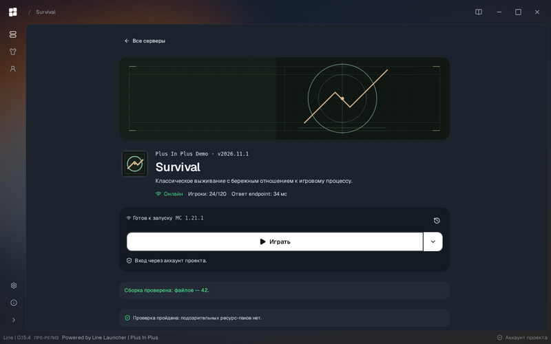</a><br><sub><b>Установить и запустить.</b> Откройте меню сервера и проверьте сборку, не запуская игру.</sub></td>
</tr>
<tr>
<td><a href="public/guidebook/navigation.gif"></a><br><sub><b>Переключаться между разделами.</b> Откройте каталог серверов или гардероб боковой панелью.</sub></td>
<td><a href="public/guidebook/wardrobe.gif">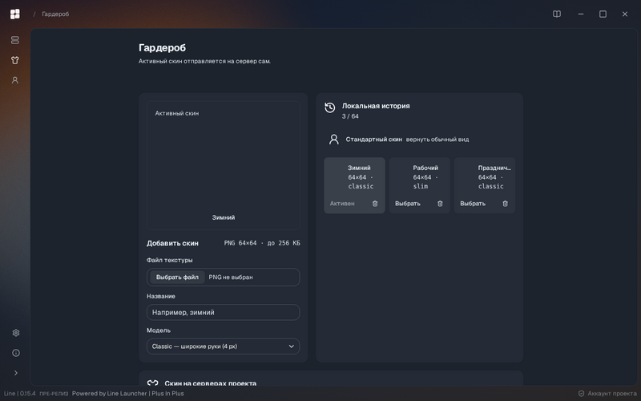</a><br><sub><b>Выбрать скин.</b> Выберите сохранённый скин, проверьте предпросмотр и верните прежний.</sub></td>
</tr>
<tr>
<td><a href="public/guidebook/account.gif">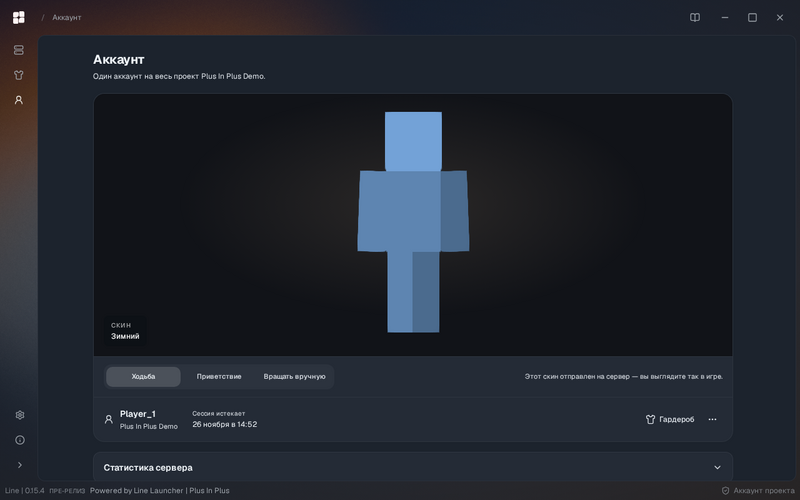</a><br><sub><b>Проверить аккаунт.</b> Откройте подробности сессии и статистику аккаунта.</sub></td>
<td><a href="public/guidebook/settings.gif">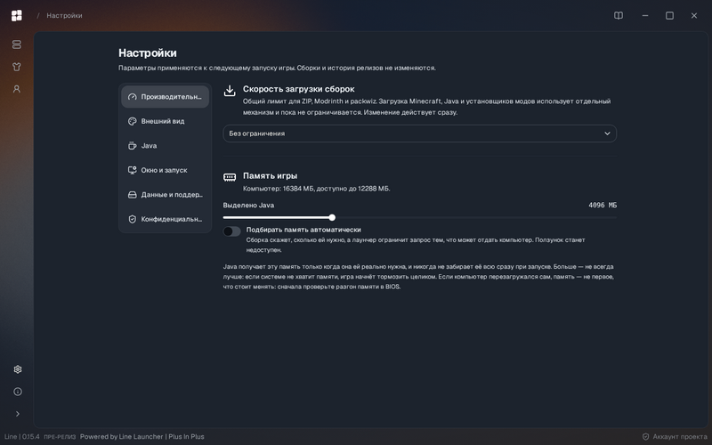</a><br><sub><b>Настроить лаунчер.</b> Измените лимит загрузки и верните исходное значение.</sub></td>
</tr>
</table>

<!-- visual-evidence-refresh:start -->

Полный набор скриншотов и GIF перегенерирован **2026-11-17** ([контрольные суммы](docs/visual-evidence.json)).
<!-- visual-evidence-refresh:end -->

Галерея показывает неподвижные постеры; нажмите на постер, чтобы открыть GIF.

GIF-файлы собираются из кадров, записанных браузером во время реальных действий
Playwright в интерфейсе приложения. Запись и обновление галереи запускаются через
`npm run screenshots`; [`scripts/generate-guidebook-gifs.py`](scripts/generate-guidebook-gifs.py)
кодирует кадры и создаёт неподвижные постеры для контролов и reduced-motion.
Источники скриншотов остаются в [`docs/images`](docs/images/).

<!-- CUSTOM BRAND DETAIL SLOT: здесь можно добавить небольшие фирменные
     графические элементы, текстуру или логотип проекта. Не заменяйте ими
     скриншоты рабочих экранов: галерея выше показывает настоящее приложение. -->

## Почему он такой

Это не «ещё один лаунчер с миллионом настроек». Решения приняты в пользу игрока,
который не должен читать форумы, чтобы поиграть:

- **Провайдер один, и он зашит.** Нет экрана выбора провайдера и нет страницы
  с адресами — их нечего настраивать.
- **Каталог — один понятный список.** Последний открытый сервер вынесен в
  витрину, а поиск, фильтры, статусы и компактные строки помогают быстро найти
  сборку и перейти к запуску.
- **Фон не исчезает за сплошными панелями.** По умолчанию главные панели —
  непрозрачные, тёмно-серые, как в JetBrains IDE; анимированный фон остаётся
  вокруг них. Прозрачное стекло можно включить в настройках.
- **Сборка проверяется до запуска, а не после падения.** Лаунчер сверяет файлы
  с манифестом провайдера, полученным по HTTPS, и показывает недостающие,
  изменённые и посторонние файлы. Ручная проверка ничего не меняет.
- **Чужие моды не удаляются.** Файл неизвестного происхождения лаунчер не
  трогает сам: он показывает список и предлагает перенести его в карантин,
  откуда файл можно вернуть.
- **Память подбирается под сборку.** Тяжёлой сборке — больше, лёгкой — меньше,
  но никогда больше, чем компьютер может отдать.
- **Java подбирается под сборку.** Подходящий рантайм ищется автоматически;
  скачивание дополнительных компонентов запрашивает согласие, когда оно нужно.
- **Данные остаются под контролем игрока.** Неизвестные моды не удаляются
  автоматически: их можно отправить в карантин, а согласие на телеметрию можно
  не давать или отозвать в настройках.

## Что внутри

- **Один провайдер на сборку.** Адрес `config.json` задаётся в
  `branding/provider.json` до сборки; серверы приходят из этого конфига.
- **Брендинг на этапе сборки.** Название, логотип и иконки — из одного файла;
  основная палитра остаётся единой для всех сборок.
- **Один аккаунт проекта.** Регистрация и вход один раз на весь лаунчер, сессия
  в Rust, одноразовый launch ticket на конкретный сервер и приватный IPC вместо
  передачи токена через аргументы JVM.
- **Целостность сборок.** Потоковая загрузка с SHA-256, защита от zip-slip,
  безопасное извлечение в проверенный релиз, отдельная живая папка игры,
  история релизов и откат.
- **Опциональный live status.** Число игроков и время ответа HTTP endpoint
  провайдера; это не измерение игрового ping.
- **Добровольная телеметрия.** Только минимальные allowlisted события при явном
  согласии игрока и настроенной политике конфиденциальности.
- **Первый запуск без сюрпризов.** Мастер сохраняет язык и вид фона локально,
  до входа в аккаунт.
- **Конфиг с кэшем.** TTL и ETag, показ кэша сразу с фоновой перепроверкой,
  безопасный отказ при несовместимой версии.
- **Локальный гардероб.** История скинов в app data, адресация по содержимому,
  идемпотентная синхронизация только активного скина.
- **Свой интерфейс.** Одна рамка окна, сворачиваемая навигация, тёмная палитра,
  Tailwind v4, Base UI, Framer Motion и Lucide React.

У режима Minecraft используется офлайн-идентичность клиента, привязанная к
аккаунту проекта; он не обходит `online-mode=true` и не заменяет авторизацию
сервера. Игрок не может подменить опубликованную провайдером сборку своей
версией через IPC.

## Сборка

Нужны Node.js 22+, Rust (stable) и зависимости Tauri для вашей платформы.

```bash
npm ci
npm run dev          # запуск в режиме разработки
npm run check        # TypeScript
npm test             # весь набор автоматических тестов
npm run build        # сборка фронтенда
```

Установщик собирается через `npm run tauri build`; пошаговая инструкция для
новичка — в [docs/BUILD.md](docs/BUILD.md).

## Данные на компьютере

В app data лежат кэш конфигурации, настройки, локальная история скинов и данные
игры. ZIP-сборки провайдера хранятся в отдельных проверенных релизах и
синхронизируются в живую папку `game/`, где остаются миры и настройки игрока.
Minecraft-профили находятся отдельно в `minecraft/<instance>/`. Перед запуском
проверяются файлы сборки; неизвестные моды можно перенести в карантин
([справочник игрока](docs/guidebook/README.md), [запуск и защита](docs/GAME.md),
[проверки](docs/ANTICHEAT.md)). Пароли и токены на диск и в WebView не
сохраняются и в логи не попадают.

## Статус

Проект не объявлен production-релизом: установка реальной сборки проверялась на
Windows, но текущие изменения требуют повторных проверок на живых экземплярах и
установщике. Что проверено локально, а что требует вашей среды —
[VERIFICATION.md](docs/VERIFICATION.md).

## Документация

| Документ                                      | О чём                                                                        |
| --------------------------------------------- | ---------------------------------------------------------------------------- |
| [BUILD.md](docs/BUILD.md)                     | Собрать с нуля: какие программы, какие файлы менять, как получить установщик |
| [START.md](docs/START.md)                     | Короткая инструкция для игрока, провайдера и разработчика                    |
| [Справочник игрока](docs/guidebook/README.md) | Поиск серверов, запуск игры, скины, настройки и типичные проблемы            |
| [Первый запуск](docs/guidebook/FIRST-RUN.md)  | Язык, оформление и переход ко входу                                          |
| [DEMO.md](docs/DEMO.md)                       | `npm run demo` — локальный провайдер и настоящее приложение                  |
| [PROVIDER.md](docs/PROVIDER.md)               | Формат конфигурации и манифеста сборки                                       |
| [GAME.md](docs/GAME.md)                       | Путь установки, проверки и запуска сборки                                    |
| [LOGGING.md](docs/LOGGING.md)                 | Логи, диагностика и безопасный отчёт                                         |
| [DESIGN.md](docs/DESIGN.md)                   | Дизайн-система, панели и правила скриншотов                                  |
| [ROADMAP.md](docs/ROADMAP.md)                 | Единственный список принятых незавершённых работ                             |
| [VERIFICATION.md](docs/VERIFICATION.md)       | Последние проверки и их границы                                              |

## Происхождение и лицензия

Разработан **Plus In Plus** на основе
[Obsy Launcher](https://github.com/obsy-official/obsy-launcher).

Оригинальные материалы Line — [Line Launcher Provider License 1.0](LICENSE):
source-available лицензия для провайдеров игровых серверов с обязательным
видимым упоминанием **Line Launcher | Plus In Plus**. Это не MIT и не
open-source лицензия. Разрешены интеграция, коммерческое использование для своих
игровых сервисов и распространение брендированных сборок их игрокам при
соблюдении условий; удаление упоминания прекращает разрешение.

Точные фразы — «Работает на Line Launcher | Plus In Plus» и «Powered by Line
Launcher | Plus In Plus». Место (футер или шапка) и язык выбираются в
`branding/line.brand.json`; «О программе» всегда повторяет упоминание.

Исходные материалы Obsy остаются под MIT: дословный текст сохранён в
[LICENSES/Obsy-MIT.txt](LICENSES/Obsy-MIT.txt). Сторонние уведомления —
[NOTICE.md](NOTICE.md). Перед публичным коммерческим релизом рекомендуется
юридическая проверка текста под вашу юрисдикцию.

<div align="center">

**Plus In Plus** · 2026

</div>
