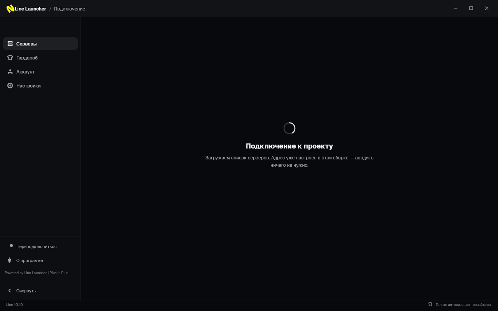
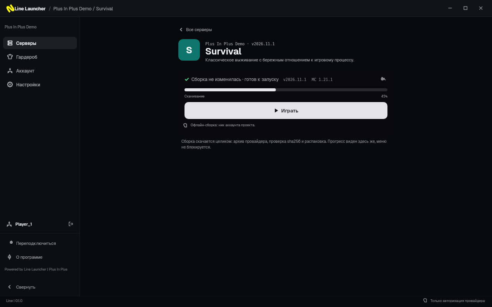
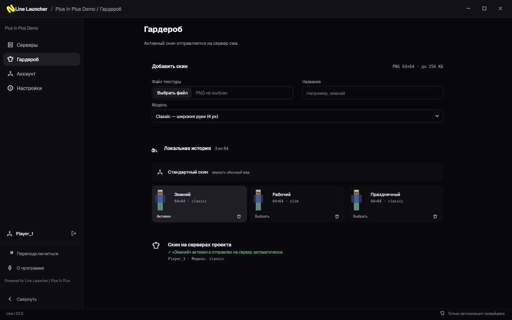

# Line Launcher

**Минималистичный Minecraft-лаунчер для игровых проектов.** Один провайдер —
один лаунчер: владелец проекта собирает приложение под себя, а игрок просто
регистрируется и нажимает «Играть».

Разработан **Plus In Plus** на основе [Obsy Launcher](https://github.com/obsy-official/obsy-launcher).
Распространяется как **source-available**, не как полностью open-source продукт;
исходные компоненты Obsy сохраняют MIT.

> **Собрать с нуля:** [docs/BUILD.md](docs/BUILD.md) — пошагово для новичка:
> какие программы поставить, какие файлы менять и как получить установщик.
>
> **Начать работу:** [docs/START.md](docs/START.md) — короткая инструкция для
> игрока, провайдера и разработчика.
>
> **Пощупать целиком:** [docs/DEMO.md](docs/DEMO.md) — `npm run demo` поднимает
> локальный демо-провайдер и запускает настоящее приложение: вход, три сервера,
> установка, запуск, гардероб, обновление и откат.

## Как это выглядит для игрока

Лаунчер уже знает адрес своего проекта — он зашит на этапе сборки. Никаких
ссылок, настроек подключения и выбора провайдера: открыл, вошёл один раз, играешь
на любом сервере проекта.

Запуск начинается с приветствия: слово **Welcome** пишется от руки, буква за
буквой, как `hello` у Apple, — и больше на экране ничего нет. Через полторы
секунды приветствие уступает странице входа.

Затемнение под словом лёгкое: сквозь него видно движущийся градиент, ради
которого всё и затевалось. Первая версия доходила до 94% чёрного по краям и
работала как крышка, а не как завеса.

Список серверов приходит из конфига провайдера, поэтому у одного проекта может
быть сколько угодно серверов — Survival, SkyBlock, Creative — со своими баннерами,
иконками, версиями и дистрибутивами.

### Один аккаунт на весь проект

Вход — отдельная страница, а не панель внутри лаунчера: пока аккаунт не принят,
рельса, каталога и настроек на экране нет вовсе. Вход происходит один раз при
первом запуске — дальше открыты все серверы проекта, отдельно логиниться на
каждом не нужно. Собственная авторизация провайдера:
аккаунт Microsoft не нужен, пароль уходит только API проекта по HTTPS, токен
сессии остаётся в Rust и не попадает в WebView. Выйти можно из меню слева — это
закрывает доступ сразу ко всем серверам.

В меню слева есть страница **Аккаунт**: имя, срок сессии и активный скин
в 3D — так, как игрок выглядит в игре. Модель можно повернуть мышью; если на
машине нет WebGL, вместо неё показывается тот же скин в плоском виде.

### Установка и запуск

Лаунчер скачивает сборку, сверяет SHA-256, безопасно распаковывает и атомарно
публикует релиз. Установленную сборку можно откатить на предыдущую.

### Гардероб с локальной историей

Скины хранятся на компьютере игрока и работают без входа и без интернета.
Прежние скины остаются в истории, а активный скин один на весь аккаунт: он
**отправляется на сервер автоматически** при выборе, входе и открытии гардероба.
Кнопки «Отправить на сервер» нет — лаунчер показывает статус синхронизации и
повторяет отправку сам, если она не удалась.

### Настройки без лишнего

Язык интерфейса, память для игры, фон лаунчера, выбор найденной Java, поведение
окна после запуска и очистка кэша конфигурации. Никаких пользовательских
JVM-флагов и ручных путей к загрузчикам.

**Язык** стоит первым, выше памяти, потому что это единственная настройка,
которая меняет то, что написано на всех остальных: игрок, которому экран
нечитаем, не должен искать её, пролистывая три раздела, которые он тоже не
может прочитать. Четыре языка — русский (основной), English, Deutsch, Français.
Все четыре словаря целиком лежат в сборке: переключение синхронное, без
перезагрузки, без загрузки бандла и без промежуточного состояния, когда экран
наполовину на одном языке, наполовину на другом. Пока игрок ничего не выбрал,
лаунчер открывается на языке системы, а русский остаётся языком по умолчанию,
если система говорит на чём-то ещё; выбранный язык хранится в настройках и
перебивает системный при следующих запусках. Названия фонов и все подписи
внутри приложения тоже переводятся — в том числе названия двенадцати градиентов.

**Фон** — двенадцать медленно движущихся градиентов: «Полярное сияние», «Зенит»,
«Садовая», «Мятная полоса», «Закатная сталь», «Медный куст», «Неоновая арка»,
«Пламя», «Ледяная крошка», «Лазурная сетка», «Северное небо», «Жемчужное
кольцо». Все двенадцать собраны рандомайзером hazeglow — тем самым, что стоит за
кнопкой «Randomize» в его генераторе, — поэтому у них разные палитры, формы,
размеры и зерно, а не одна картинка в двенадцати оттенках.

Выбор — компактный: одна строка с текущим фоном, из неё выпадает список имён, а
рядом с наведённым пунктом открывается окно с живым превью — тот же градиент,
что будет на странице. Выбор сохраняется и переключается плавным растворением.
У каждого фона своя сила затемнения — иначе светлые («Жемчужное кольцо»,
«Мятная полоса») засвечивали бы шапку и её кнопки.

**Лаунчер при запуске игры** — что делать, когда Minecraft стартовал:
**«Скрывать в трей»** (окно уходит из панели задач, иконка остаётся в трее),
**«Свернуть»** (остаётся в панели задач), **«Закрыть лаунчер»** или
**«Оставить как есть»**. Что бы ни было выбрано, когда игра закрывается или
падает, лаунчер возвращается сам — это не настройка, а обещание.

> Все скриншоты — одного размера, **1280×800**, и это проверяется тестом
> (`tests/screenshots.test.ts`), чтобы галерея снова не поехала по высоте.
> В обычной сборке их снимает браузер: `npm run screenshots` (Chrome/Edge,
> настоящие компоненты с демо-проектом из [`examples/`](examples/)). Там, где
> браузера нет, те же экраны рисует `npm run screenshots:offline`: он читает
> палитру из `src/index.css` и шрифт Geist, но это векторная отрисовка
> токенами, а не снимок живого WebView. Изображения в репозитории обновлены
> офлайн-рендером.

## Что внутри

- **Один провайдер на сборку.** Адрес `config.json` задаётся в
  `branding/provider.json` до сборки; серверы приходят из этого конфига.
- **Брендинг на этапе сборки.** Название, палитра, логотип и иконки приложения —
  из одного файла. Пресеты и точечные переопределения семантических цветов.
- **Один аккаунт проекта.** Регистрация и вход один раз на весь лаунчер, сессия
  в Rust, одноразовый launch ticket на конкретный сервер и приватный IPC вместо
  передачи токена через аргументы JVM.
- **Целостность сборок.** Потоковая загрузка с SHA-256, защита от zip-slip,
  атомарная публикация, история релизов и откат.
- **Конфиг с кэшем.** TTL и ETag, показ кэша сразу с фоновой перепроверкой,
  безопасный отказ при несовместимой версии.
- **Локальный гардероб.** История скинов в app-data, адресация по содержимому,
  автоматическая идемпотентная синхронизация только активного скина.
- **Свой интерфейс.** Одна рамка окна, сворачиваемая навигация, тёмная палитра
  Obsy, Tailwind v4, Base UI, Framer Motion и Lucide.
- **Один дизайн, вес без балласта.** Раньше в проекте жил второй, «старый»
  интерфейс: отдельный лист стилей, ветки в компонентах, сборочный флаг и
  песочница для сравнения. Его убрали целиком — поддерживать, тестировать и
  снимать скриншоты ради отката, который не понадобился, дороже, чем он стоит.
  Единственное оформление, которое теперь есть, — то, что видит игрок, и это
  же оформление описывают документация и скриншоты.

Чего сознательно нет: Microsoft/offline-аккаунтов, ручного выбора загрузчиков,
аддонов, виджетов и произвольных JVM-флагов.

## Статус

Первый вертикальный срез, **не готовый production-релиз**. Запуск Minecraft
реализован на стороне лаунчера, но ещё не проверен с реальной сборкой. Exchange
endpoint и интеграция мода с сессией Minecraft остаются ответственностью
провайдера; справочный Java-клиент приложен в [`examples/`](examples/).

Что проверено локально, а что требует вашей среды — [docs/VERIFICATION.md](docs/VERIFICATION.md).

## Документация

| Документ                                | О чём                                        |
| --------------------------------------- | -------------------------------------------- |
| [BUILD.md](docs/BUILD.md)               | Сборка с нуля: программы, файлы, установщик  |
| [INSTALLER.md](docs/INSTALLER.md)       | Установщик: настройка вида и сборка под ОС   |
| [START.md](docs/START.md)               | Быстрый старт: игрок, провайдер, разработчик |
| [DEMO.md](docs/DEMO.md)                 | Демо-режим: всё приложение одной командой    |
| [GAME.md](docs/GAME.md)                 | Запуск сборки, каталоги, защита файлов       |
| [BRANDING.md](docs/BRANDING.md)         | Палитра, логотипы, адрес провайдера, иконки  |
| [DESIGN.md](docs/DESIGN.md)             | Дизайн-система, фоны, тени, движение         |
| [PROVIDER.md](docs/PROVIDER.md)         | Контракт API и формат `config.json`          |
| [ARCHITECTURE.md](docs/ARCHITECTURE.md) | Устройство, решения безопасности, roadmap    |
| [RUNBOOK.md](docs/RUNBOOK.md)           | Подробные инструкции и ручные проверки       |
| [VERIFICATION.md](docs/VERIFICATION.md) | Что проверено и с какими ограничениями       |

## Данные на компьютере

Каталог app data пользователя: `config-cache.json`, `skins/` (локальная история
скинов) и `instances/<server-id>/` с проверенными релизами и атомарным
указателем текущего. У каждого сервера своя сборка (`releases/<sha256>`) и свой
каталог игрока (`game/`): миры и настройки не пересекаются и не теряются при
обновлении. Перед запуском каждый файл сборки сверяется с индексом sha256 —
посторонние удаляются, изменённые и отсутствующие скачиваются заново
([docs/GAME.md](docs/GAME.md)). Пароли и токены на диск и в WebView не сохраняются.

## Лицензия

Оригинальные материалы Line — [Line Launcher Provider License 1.0](LICENSE):
source-available лицензия для провайдеров игровых серверов с обязательным
видимым упоминанием **Line Launcher | Plus In Plus**. Это не MIT и не open-source
лицензия. Разрешены интеграция, коммерческое использование для своих игровых
сервисов и распространение брендированных сборок их игрокам при соблюдении
условий. Удаление упоминания прекращает разрешение; отдельные права требуют
письменного согласия Plus In Plus.

Точные фразы: «Работает на Line Launcher | Plus In Plus» / «Powered by Line
Launcher | Plus In Plus». Место (футер или шапка) и язык выбираются в
`branding/line.brand.json`; «О программе» всегда повторяет упоминание.

Исходные материалы Obsy остаются под MIT: дословный текст сохранён в
[LICENSES/Obsy-MIT.txt](LICENSES/Obsy-MIT.txt). Новая лицензия Line не отзывает
права на upstream. Сторонние уведомления — [NOTICE.md](NOTICE.md) и
[LICENSES/](LICENSES/). Перед публичным коммерческим релизом рекомендуется
юридическая проверка текста под вашу юрисдикцию.
