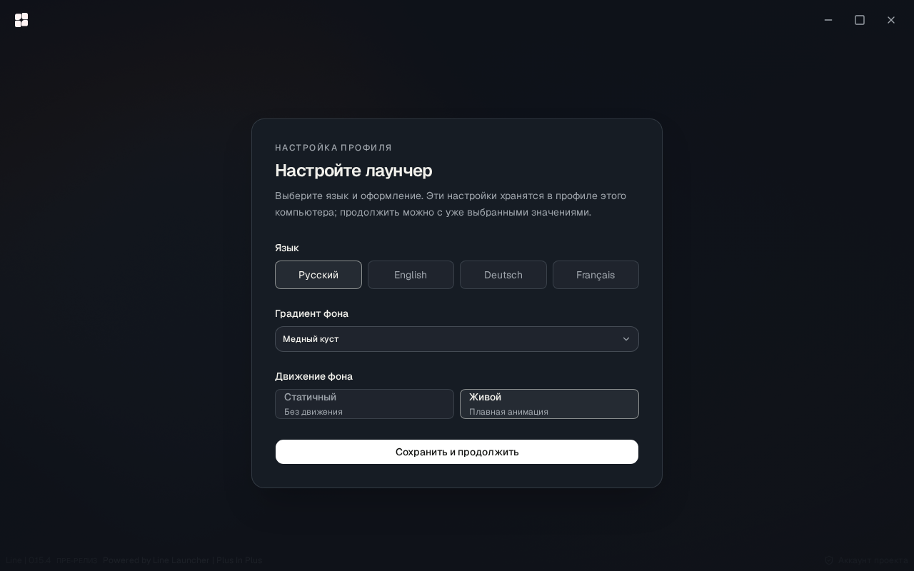
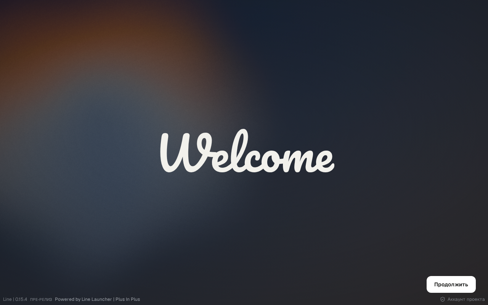
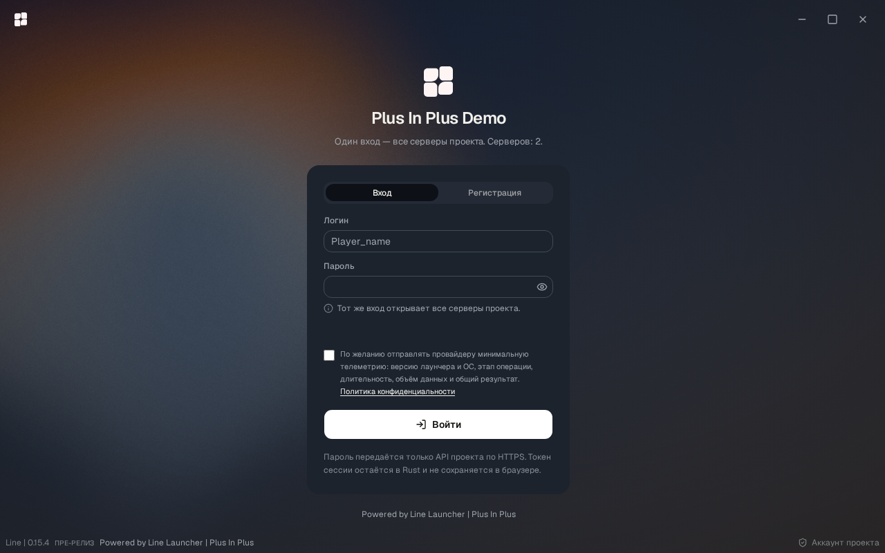

# Первый запуск и мастер настроек

Мастер появляется при первом запуске до входа в аккаунт. Выборы сохраняются в
локальных настройках этого компьютера; их можно изменить позже.

## 1. Приветствие

Короткая заставка **Welcome** показывает, что лаунчер открылся. Она не загружает
сборку и не ждёт ответа провайдера. Нажмите **Продолжить** или дождитесь перехода
к следующему экрану.

## 2. Настройте вид

В мастере доступны три решения:

1. **Язык интерфейса:** русский, английский, немецкий или французский.
2. **Градиент фона:** выбрать один из встроенных вариантов.
3. **Движение фона:** живой вариант или статичный фон без анимации.

Нажмите **Сохранить и продолжить**. Пока настройки сохраняются, повторно
отправить форму нельзя. Если сохранение завершится ошибкой, мастер покажет её и
позволит попробовать снова.

## 3. Войдите в аккаунт проекта

После сохранения мастер уступает место входу или регистрации. Это аккаунт
игрового проекта, а не Microsoft. Один вход открывает каталог проекта.

Если провайдер настроил endpoint телеметрии и политику конфиденциальности,
форма может предложить необязательное согласие. Оно выключено по умолчанию;
отказ не блокирует вход или запуск. Что именно может отправляться и где отозвать
согласие — в [странице приватности](SAFETY-PRIVACY.md#телеметрия).

## Позже изменить выбор

- Язык и градиент можно изменить в **Настройки → Внешний вид**.
- Движение фона включается или отключается там же.
- Если старые настройки уже существуют, лаунчер не должен навязывать повторный
  onboarding; мастер предназначен для первого запуска нового профиля.

Подробное описание поведения первого запуска и настроек — в
[SETTINGS.md](SETTINGS.md).
