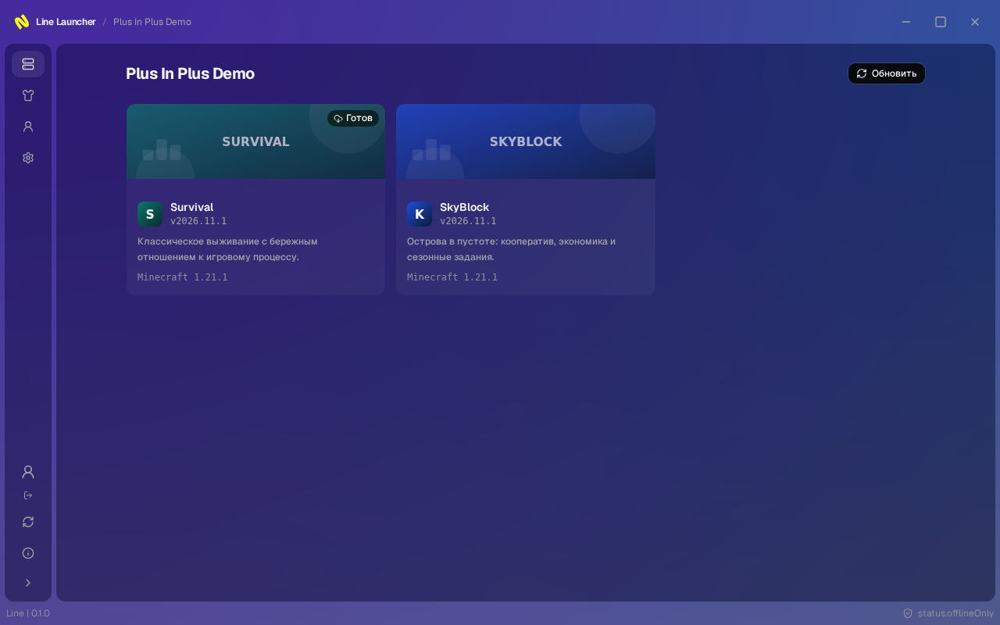
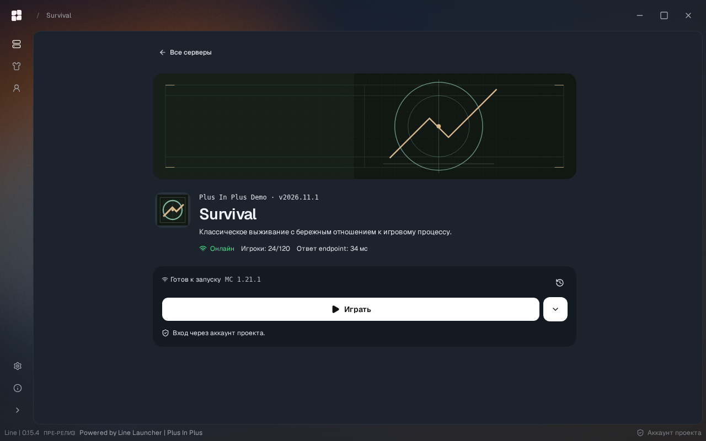
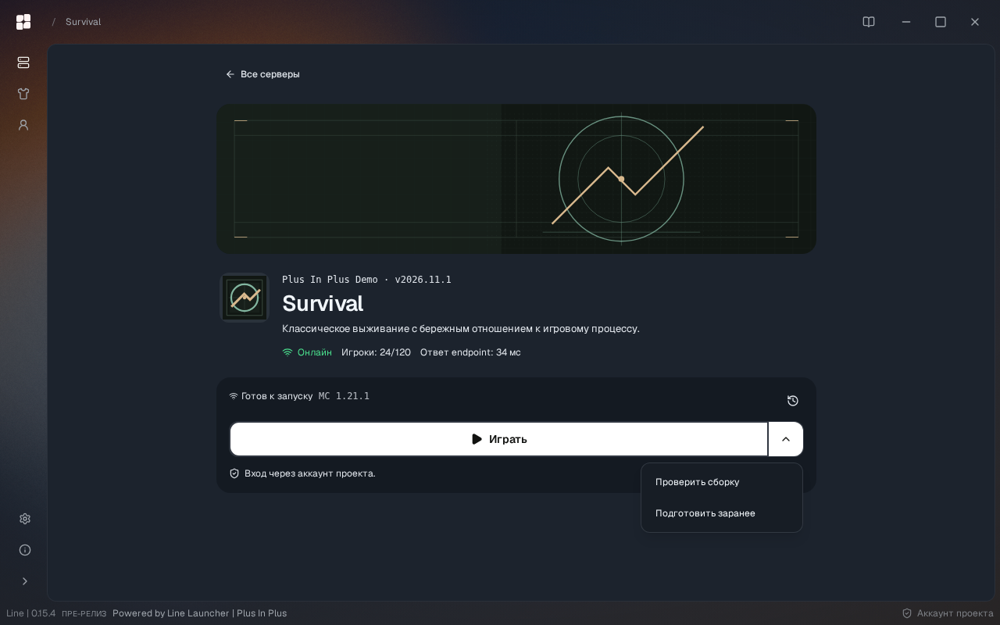
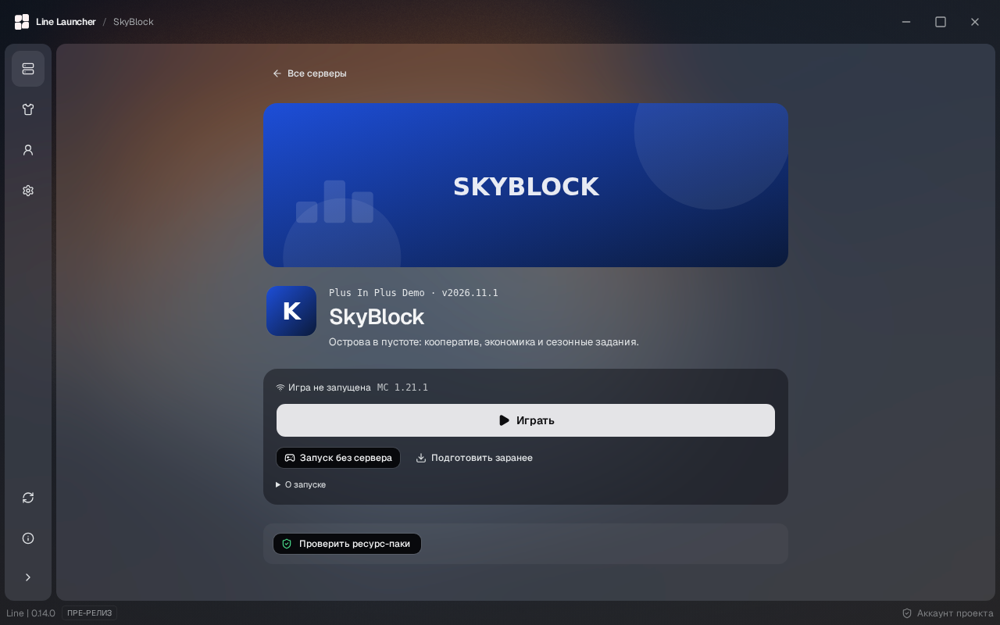

# Найти сервер и начать играть

## Найти сервер

Откройте **Серверы** на боковой панели. Введите часть названия в поиск или сузьте список фильтрами. Строка показывает сервер и его состояние; откройте её, чтобы посмотреть подробности и доступные действия.

Если список разделён на личные группы, выберите нужную группу или измените порядок элементов доступными ручками перетаскивания. Последний выбранный сервер может отображаться отдельно для быстрого продолжения.

## Установить или обновить сборку

На странице сервера основная кнопка сообщает следующий шаг: установить, обновить, отменить текущую задачу, играть или остановить игру. Во время загрузки она показывает прогресс. Не закрывайте приложение, пока операция не завершилась, если система не сообщила, что её можно безопасно возобновить.

Дополнительные команды находятся в меню рядом с основной кнопкой. Например, проверка целостности только сравнивает файлы с проверенным индексом и не ремонтирует их.

## Запустить игру

Нажмите **Играть**. Если сборка содержит дополнительные компоненты, лаунчер запросит подтверждение перед их загрузкой. Вы можете отказаться; тогда неподтверждённая загрузка продолжаться не должна.

Некоторые сборки открывают режим Minecraft. Версию, загрузчик, адрес сервера и идентификатор экземпляра определяют конфигурация и проверенная сборка. Действие «Запуск без сервера» отключает автоматическое подключение, но не отменяет требования авторизации самого сервера.

## Если запуск не удался

Прочитайте сообщение и выполните указанный шаг. При запросе на дополнительный компонент проверьте его назначение и источник, прежде чем подтверждать. Для ошибки установки откройте сообщение в журнале; не удаляйте вручную папки релизов, если нужна диагностика или откат.

**Подробнее:** [статусы установки](INSTALL-STATUS.md) · [типичные проблемы](TROUBLESHOOTING.md) · [техническая справка по маршруту установки](../GAME.md)
