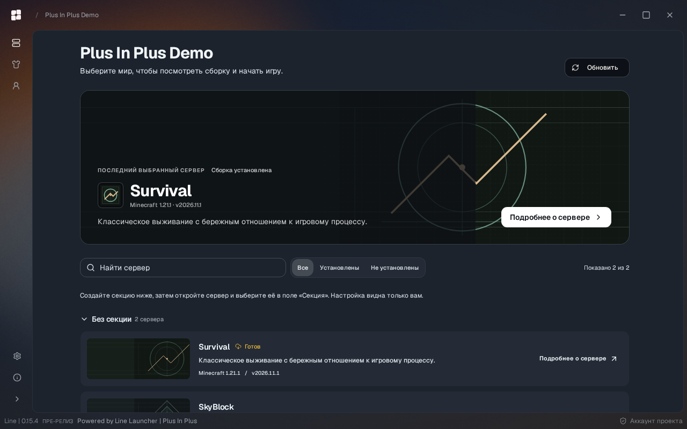
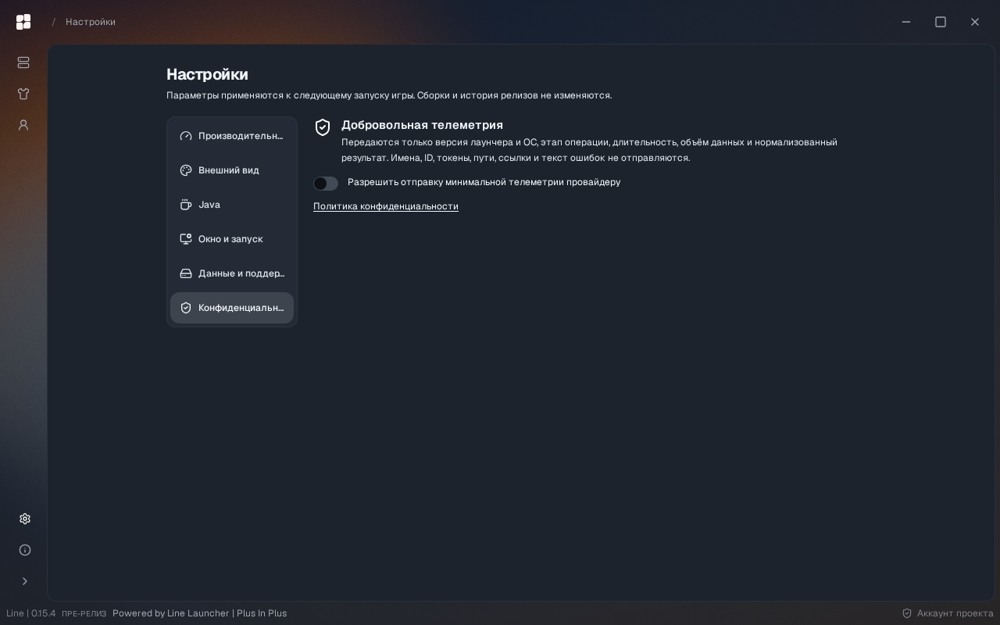

# Гайдбук игрока

Короткие страницы о том, как пройти путь от первого открытия лаунчера до игры и
что происходит с файлами на этом пути.

> Скриншоты сделаны из настоящего React-интерфейса на демо-данных. Статусы,
> количество игроков и ответы IPC для галереи подставлены тестовой средой — это
> не живой сервер и не подтверждение реальной авторизации или установки.

## Страницы

| Страница                                        | Что внутри                                                        |
| ----------------------------------------------- | ----------------------------------------------------------------- |
| [Первый запуск и мастер настроек](FIRST-RUN.md) | Язык, градиент, движение фона и переход ко входу                  |
| [Каталог и запуск игры](PLAY.md)                | Страница сервера, меню действий, загрузка и распаковка ZIP-сборки |
| [Безопасность и приватность](SAFETY-PRIVACY.md) | Проверка файлов, моды и карантин, согласие на телеметрию          |
| [Настройки](SETTINGS.md)                        | Внешний вид, производительность, Java, окно и приватность         |

Для провайдера контракты конфигурации, `pack.json` и live status описаны в
[PROVIDER.md](../PROVIDER.md). Технический маршрут сборки — в
[GAME.md](../GAME.md) и [MINECRAFT.md](../MINECRAFT.md).

## Экран каталога

Каталог показывает серверы одного проекта. Поиск, фильтры и личные секции
помогают найти нужный сервер; последний открытый сервер может появиться в блоке
быстрого продолжения. Live status отображается только если провайдер настроил
HTTPS endpoint. Его время ответа — это round-trip HTTP-запроса, а не игровой
задержки до Minecraft-сервера.

## Настройки приватности

Телеметрия необязательна. На скриншоте переключатель выключен; решение игрока
можно изменить в настройках, если провайдер предоставил и HTTPS endpoint, и
ссылку на политику конфиденциальности.
