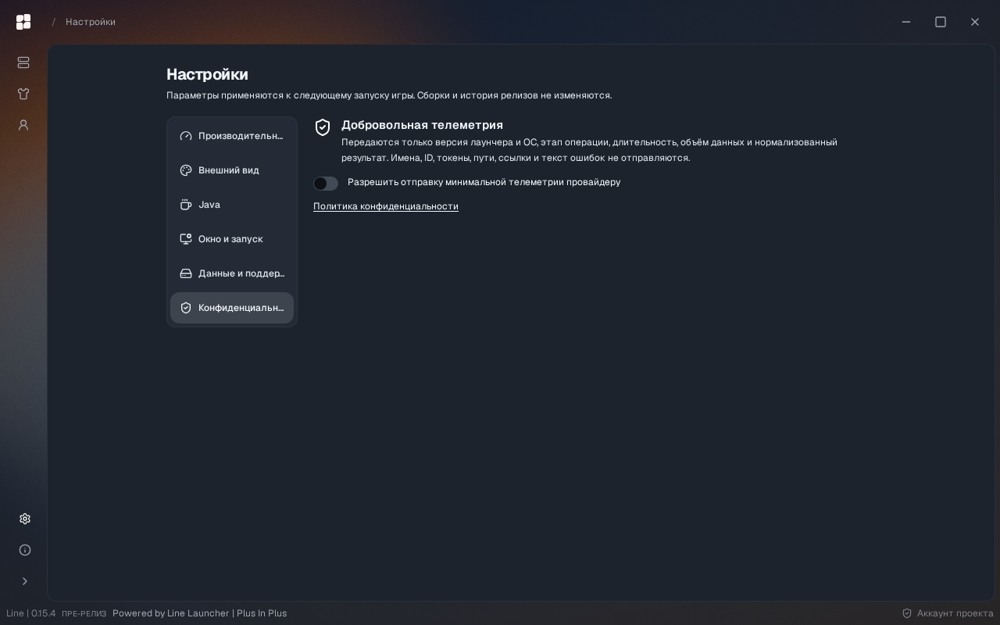

# Безопасность файлов и приватность

## Проверка целостности

Сборка проверяется до запуска. Лаунчер сравнивает файлы с индексом проверенного
релиза и показывает отсутствующие, изменённые и посторонние элементы. Проверка
через меню ничего не исправляет и не удаляет.

В архиве проверяются пути, размеры и хеш архива; распаковка использует
проверяемые относительные пути и отдельный staging-каталог. Неизвестный файл не
становится доверенным только потому, что лежит в папке `mods/`.

## Моды и карантин

Если лаунчер не может подтвердить происхождение JAR-файла относительно текущего
проверенного релиза, он показывает этот файл как непроверенный. Он не должен
удаляться автоматически. Игрок может открыть действие **Карантин** и переместить
конкретно перечисленные файлы в отдельное хранилище; оттуда их можно
восстановить. Неизвестные и изменённые файлы не следует запускать, пока их
происхождение не установлено.

Для провайдерских модов и ресурс-паков описание проверок см. в
[ANTICHEAT.md](../ANTICHEAT.md).

## Телеметрия

Телеметрия появляется только если провайдер публикует оба HTTPS адреса:
endpoint и политику конфиденциальности. Согласие:

- выключено по умолчанию;
- не обязательно для входа, скачивания или запуска;
- можно отозвать в **Настройки → Приватность**.

Разрешённые поля ограничены версией лаунчера, операционной системой, этапом,
длительностью, необязательным объёмом данных и нормализованным результатом.
Имена, игровые ID, токены, локальные пути, URL операций и сырой текст ошибок не
включаются в payload. Ссылка на политику открывает страницу провайдера.

## Что важно помнить

Проверка хеша подтверждает соответствие опубликованному индексу, но сама по себе
не доказывает, кто создал релиз. Доверие начинается с конфигурации и HTTPS
провайдера. При сомнении остановитесь и обратитесь к проекту, который выдал
лаунчер.
