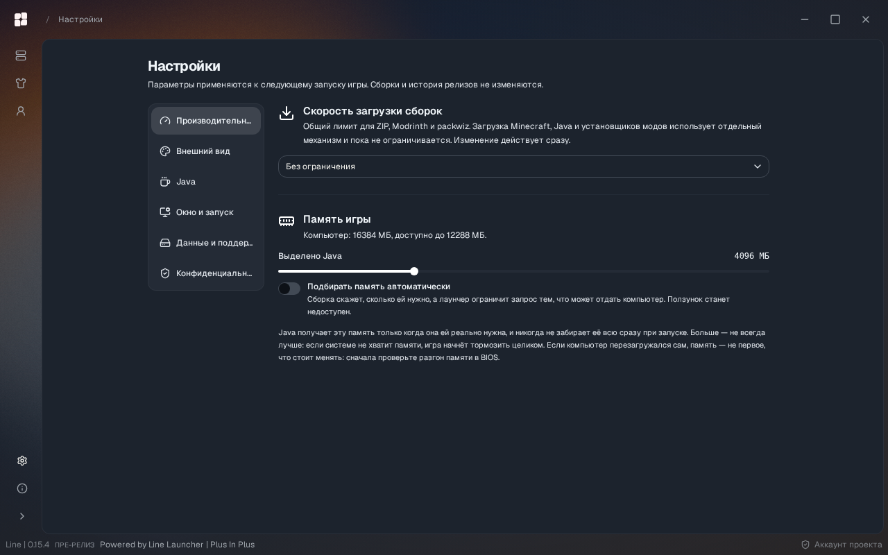
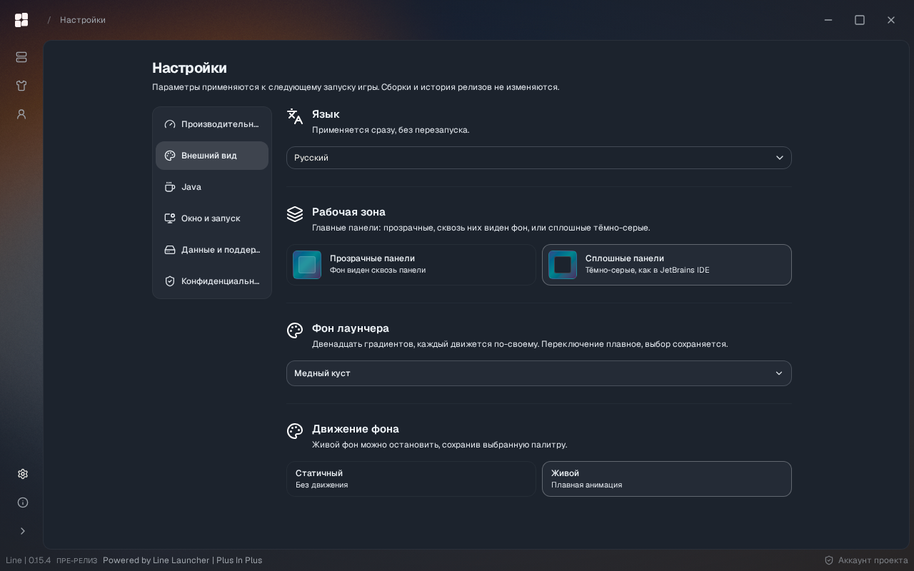

# Настройки лаунчера

Настройки разделены на категории. Переключение языка происходит сразу; остальные
изменения сохраняются локально и подтверждаются приложением. Часть параметров
применяется со следующего запуска игры.

## Производительность

- ограничение скорости загрузки архивов сборок;
- объём памяти Java вручную или автоматический подбор;
- справочная оценка доступной памяти компьютера.

Автоматический подбор ограничивает запрос памяти возможностями устройства. Он
не обещает, что любая сборка и любые моды поместятся в выбранный объём.

## Внешний вид

Здесь доступны язык, фон/градиент, движение фона, оформление рабочих панелей и
другие параметры вида. Статичный фон отключает его движение, не меняя саму
палитру. Оформление панелей и фон настраиваются независимо.

## Java

Лаунчер ищет подходящий рантайм и проверяет выбранный путь. Если конкретной
сборке нужна другая версия Java, интерфейс объяснит требование; не скачивайте
исполняемые файлы из неизвестных источников.

## Окно и запуск

Категория управляет поведением окна и действиями после запуска. Эти параметры
не меняют проверенную сборку сервера.

## Данные и поддержка

Здесь находятся действия с локальным кэшем и журналами. Не отправляйте журналы
публично без проверки: перед передачей используйте описанный в
[LOGGING.md](../LOGGING.md) формат отчёта.

## Приватность

Если провайдер настроил endpoint и политику, появится отдельная категория
**Приватность**. Переключатель изначально выключен; его можно оставить в этом
состоянии или в любой момент отозвать согласие.
