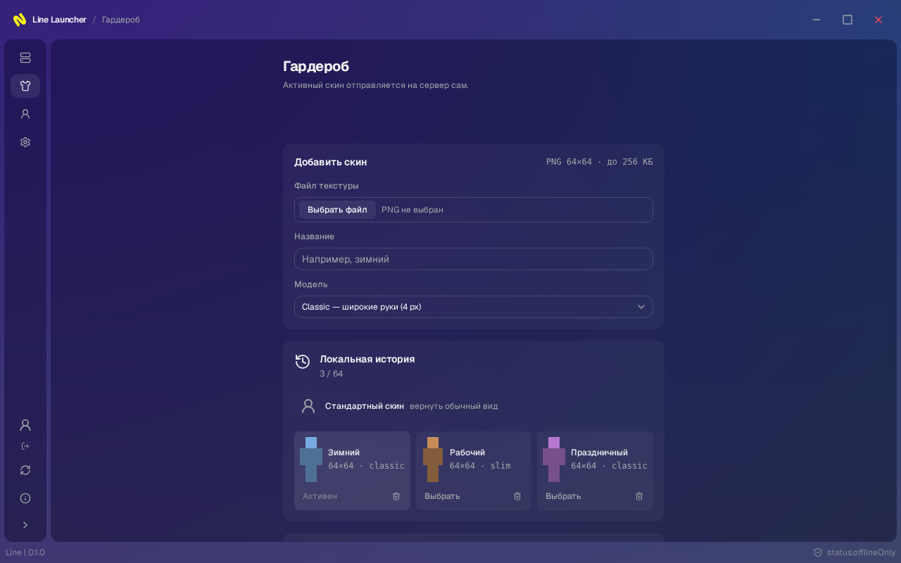

# Управлять скинами

Откройте **Гардероб**, чтобы посмотреть текущий скин и сохранённые локально варианты. Выберите скин в истории, чтобы сделать его активным. Активный выбор отмечен в списке.

## Добавить скин

Используйте форму добавления и укажите имя или поддерживаемый адрес скина — в зависимости от показанных полей. Перед сохранением проверьте предпросмотр. Если файл или адрес недоступен, интерфейс сообщит об ошибке; существующая история при этом не должна незаметно заменяться.

Локальная история относится к лаунчеру. Сервер может использовать собственную систему скинов и не показывать выбранный здесь вариант другим игрокам.

**Дальше:** [настройки лаунчера](SETTINGS.md) · [локальные данные](DATA.md) · [справочник](README.md)
